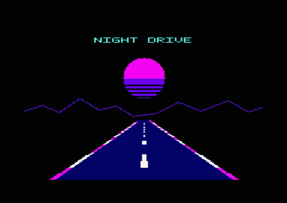
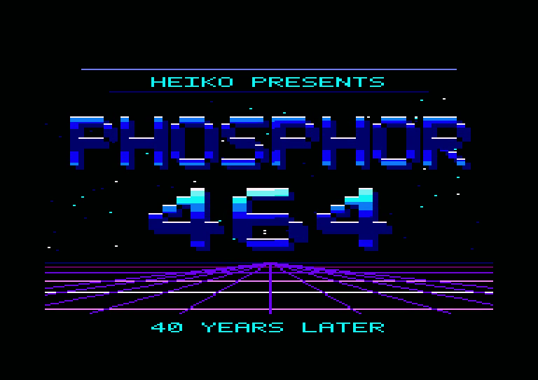
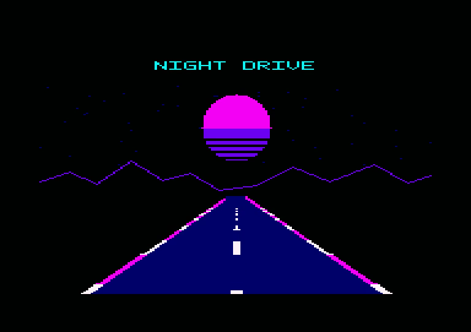
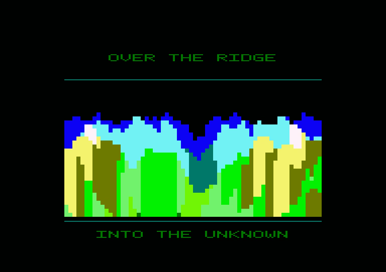
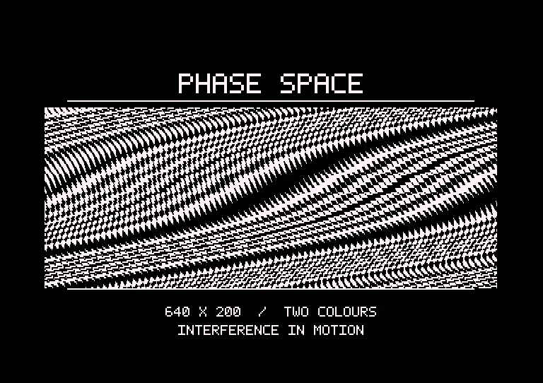

# PHOSPHOR 464

### Seven scenes. 64 KiB. One very busy Z80.

PHOSPHOR 464 is a demoscene experiment from **Pompixel** for the Schneider CPC 464. It brings a mountain flight, neon roads, raster effects and original AY music to a 64 KiB machine. The demo loads once from tape and runs entirely from RAM.

**[Watch the complete demo with sound (MP4)](media/phosphor-464.mp4)** · [Explore the Z80 source](src/phosphor464.asm) · [Read the annotated listing](listings/phosphor464-kommentiert.lst)

*This is a work in progress. The video and measurements come from an emulator. A test on an original CPC 464 is still ahead of us.*

## What you are looking at

| | |
|:---:|:---:|
|  |  |
| **Phosphor**: a chrome logo lit one raster line at a time | **Night Drive**: a road that accelerates towards the viewer |
|  |  |
| **Over the Ridge**: a flight through a generated valley | **Phase Space**: moving interference in 640 × 200 Mode 2 |

The full show runs for almost 64 seconds across seven scenes, with original graphics and an AY soundtrack. Its 128-step sequencer drives arpeggio, bass and percussion through the CPC's sound hardware.

## The hardware tricks

**A stack that reads the landscape.** The terrain renderer temporarily points the Z80's stack pointer at a prepared address list and uses `POP DE` to fetch table entries. Interrupts stay disabled while it does this. When rendering finishes, the routine restores the original stack pointer. It also uses `IXL`, an undocumented half of the Z80's index register, as working storage.

**A valley drawn from a height map.** A 64 × 64 height map and projection tables describe the landscape. The Z80 samples 64 viewing rays, checks which parts remain visible and draws the result at runtime. It builds eight columns per video frame into a hidden screen; after eight frames, the CRTC switches to the finished image. That is approximately 6.26 new terrain views per second while video output and music continue at approximately 50.08 Hz.

**Light without repainting the logo.** The opening chrome effect changes Gate Array colours at raster-line intervals. The graphic data stays in place while the colours move across it.

**Two display modes in one frame.** The demo switches from colourful Mode 0 to high-resolution Mode 2 during the same picture. The Phase Space scene then uses two screen buffers to animate its fine monochrome patterns.

**Every byte has a job.** The current program, including compressed graphics and tables, occupies 28,813 bytes. It reuses the lower 16 KiB of RAM for different scenes and screen buffers after switching off the ROMs. The demo uses no memory expansion.

## Test status

The current version has passed 21 scene tests in AMSpiriT Lite, covering CRTC types 0, 1 and 2. The complete terrain flight was checked against a reference renderer, and the CPC firmware loaded and started the tape image in the emulator. Original hardware, the physical tape adapter and the colour monitor still need testing.

The animated preview has no sound. The [full recording](media/phosphor-464.mp4) includes the AY soundtrack.

## Source and tools

The [commented Z80 source](src/phosphor464.asm) and [annotated listing with machine bytes](listings/phosphor464-kommentiert.lst) capture the current development version. Build tools and supporting assets are not yet in this repository, so this snapshot cannot yet be rebuilt on its own.

Developed and tested with [AMSpiriT Lite](https://github.com/AMSpiriT-Emulator/amspirit-releases) and assembled with [RASM](https://github.com/EdouardBERGE/rasm). The project uses RASM's LZ48 decompressor.
